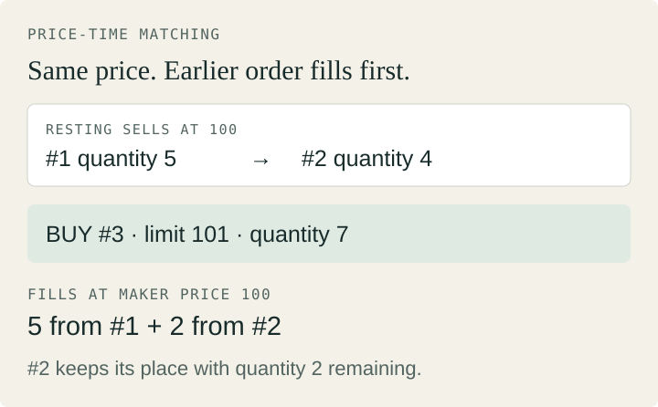

# Java Order Book

**Price first. Time breaks the tie.**

A Java 21 matching engine for one instrument: integer price ticks, FIFO priority, deterministic partial fills and cancellation. One thread owns the book. The core has no external runtime dependencies.

[Matching code](src/main/java/dev/hajar/orderbook/OrderBook.java) · [Design](docs/design.md) · [Tests](src/test/java/dev/hajar/orderbook/) · [JMH results](benchmarks/RESULTS.md) · [JVM profile](docs/jvm-profile.md)



## Small core, explicit trade-offs

- **Ordered price levels:** two `TreeMap`s find the best bid and ask. Matching executes at the resting maker's price.
- **FIFO without a cancellation scan:** a doubly linked queue per price level plus an active-ID `HashMap` lets cancellation find and unlink a node. Removing an empty price level still costs O(log P).
- **One ownership boundary:** matching, quantities, queues and ID lookup change together. A concurrent map would not make that compound operation atomic.
- **Allocation stays visible:** boxed keys, nodes and immutable results favor clarity. JMH and JFR characterize the costs before considering pools or primitive collections.

[Exact rules, complexity bounds and invariants](docs/implementation.md)

## Correctness before timing

**20 tests**, including **60,000 generated commands** (40 fixed seeds × 1,500 commands), compare fills, rejection behavior and remaining state against an independent list-based model. Structural checks and quantity conservation add separate checks. This is a finite regression set, not a proof over every input.

Install **JDK 21** and **Maven 3.9.x**, then run:

```sh
mvn --batch-mode verify
java -jar target/orderbook-lab-1.0.0.jar
```

```text
TRADE maker=1 taker=3 price=100 quantity=5
TRADE maker=2 taker=3 price=100 quantity=2
CANCEL 2 true
ACTIVE 0
```

## Measure the implemented boundary

```sh
mvn --batch-mode -Pbenchmarks -DskipTests package
java -jar target/benchmarks.jar -prof gc -rf json -rff benchmarks/results.json
```

JMH uses warm-up, two JVM forks, bounded workloads and allocation profiling. The recorded mixed batch allocated **1,304 bytes**; the sweep batch allocated **2,992 bytes**. These are different batches, with six and nine commands respectively, not interchangeable per-order figures.

[Results and confidence intervals](benchmarks/RESULTS.md) · [Workloads and environment](benchmarks/README.md) · [Raw JSON](benchmarks/results.json)

**Scope:** an educational in-memory simulation. No network, concurrent writers, persistent idempotency or durable recovery. Batch percentiles exclude queueing and cannot be divided into per-order latency. [Full semantics and limits](docs/implementation.md#scope).
